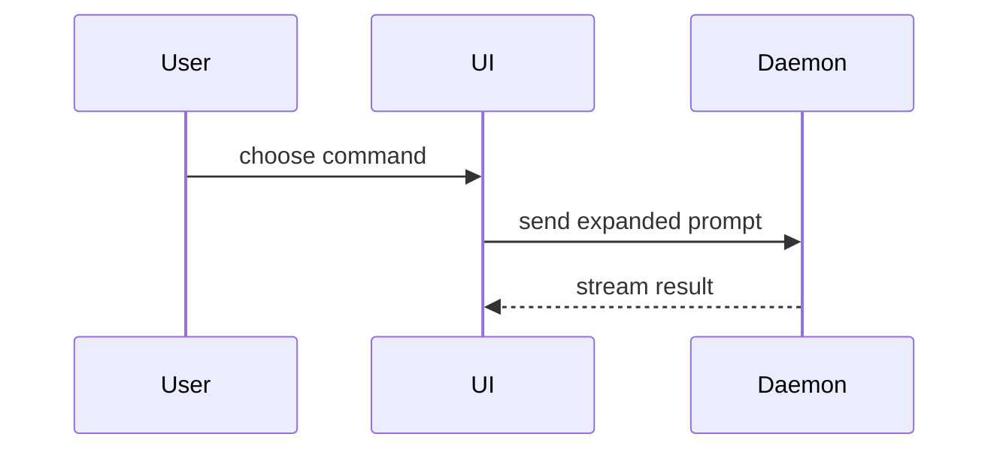

PR 본문은 이 템플릿으로 작성하세요.

```markdown
## 요약

<다이어그램, diff 스케치, 또는 트리>

## 증거

- **이전:** <스크린샷/출력/실패하는 테스트 실행 결과>
  **이후:** <스크린샷/출력/통과하는 테스트 실행 결과>

## 병합 위험

**문:** <일방향 또는 양방향>

<선택: 설명>

**영향 범위:** <한 단어 설명>

<선택: 병합이 가져올 수 있는 파급 효과>
```

## 섹션

서두는 모두 생략하고 산문은 짧게 유지하세요. `GLOSSARY.md`에 있는 사용자의 도메인 언어를 사용하세요.

### 요약

핵심을 가장 분명하게 전달하는 가장 작은 뷰를 고르세요.

- 로직이나 알고리즘은 의사코드로 보여 줍니다.

```text
on(save)
  if content is unchanged
    return cached result
  write new content
  return fresh result
```

- 런타임 제어 흐름은 호출 트리로 보여 줍니다.

```text
submitForm
  createSession
    persistPrompt
    launchAgent
  navigateToSession
```

- UI 구조는 컴포넌트 트리로 보여 주되, 중요한 상태와 모듈 경계를 포함합니다.

```text
<SessionPage> (apps/example/src/routes/session.tsx)
  useSessionEvents()
  <SessionToolbar>
    <RunSkillButton> (packages/ui)
```

- 파일별 책임이나 넓은 리팩터링은 얕은 파일 트리로 보여 줍니다.

```text
src/
├── commands/       # 사용자 동작을 파싱
├── sessions/       # 세션 상태를 소유
└── transport/      # API 요청을 전송
```

- 컴포넌트 간 상호작용, 제어 흐름, 데이터 흐름은 Mermaid로 보여 줍니다.



- 무엇이 바뀌는지가 핵심이고 주변 구조는 이미 존재할 때는 `diff`를 사용하세요. diff의 형태는 주제에 맞추세요.

컴포넌트 변경:

```diff
 <SessionPage>
   useSessionEvents()
   <SessionToolbar>
+    <RunSkillButton />
   <SessionTimeline>
+    <SkillResultCard />
```

파일 배치 변경:

```diff
 src/
 ├── commands/
+│   └── show-me.ts       # 슬래시 명령을 확장
 ├── sessions/
-└── transport.ts
+└── transport/
+    ├── client.ts
+    └── stream.ts
```

호출 트리나 콜 스택 변경:

```diff
 submitForm
   createSession
     persistPrompt
+    expandSkillMention
     launchAgent
-  navigateToSession
+  navigateToSession
+    subscribeToEvents
```

상태나 제어 흐름 변경:

```diff
 on(save)
-  write content
+  if content is unchanged
+    return cached result
+  write new content
+  invalidate cache
```

- 블록의 대부분이 새 코드이거나, 생략된 맥락 때문에 소유 관계나 순서가 가려지거나, 사용자가 복사해 쓸 목표 형태가 필요할 때는 블록 전체를 보여 줍니다.

```ts
function expandSkill(command: string): string {
  const skillName = command.slice(1);
  return `use the ${skillName} skill`;
}
```

#### 지침

각 시각 자료는 그것이 뒷받침하는 짧은 글 바로 옆에 두세요. 사용자의 현재 질문에 답하거나 현재 논의점을 풀 선택지를 보여 주는 데 필요한 호출, 파일, props, 상태, 경계만 남기세요.

이 중 하나만 쓸 수도, 여러 개를 쓸 수도 있지만, 전부 쓸 일은 거의 없습니다. 판단해서 사용자를 압도하지 마세요.

### 증거

변경이 동작한다는 구체적인 증거입니다. 이전과 이후를 보여 주세요.

스크린샷이 S등급입니다. 환경이 갖춰져 있고 변경이 시각적일 때 그렇습니다.

실행 기반 증거는 A등급입니다. 테스트 결과, 콘솔 출력 등입니다. 이제 실패하던 것이 통과하는 정확한 테스트를 의사코드로 보여 주세요.

### 병합 위험

일방향 문인지 양방향 문인지 설명하세요. 양방향 문은 되돌아올 수 있지만 일방향 문은 그럴 수 없습니다. 롤백 비용이 낮은 PR은 위험이 더 낮습니다. 파괴적인 동작이나 되돌리기 어려운 결정이 포함된 변경은 일방향 문입니다.

영향 범위는 이 PR이 가져오는 변경의 잠재적 영향 또는 범위입니다. 가능한 모든 경우를 고려하세요. 예를 들면 레이아웃 이동, 소비자 측 장애, 모바일 반응형 문제 등입니다.
